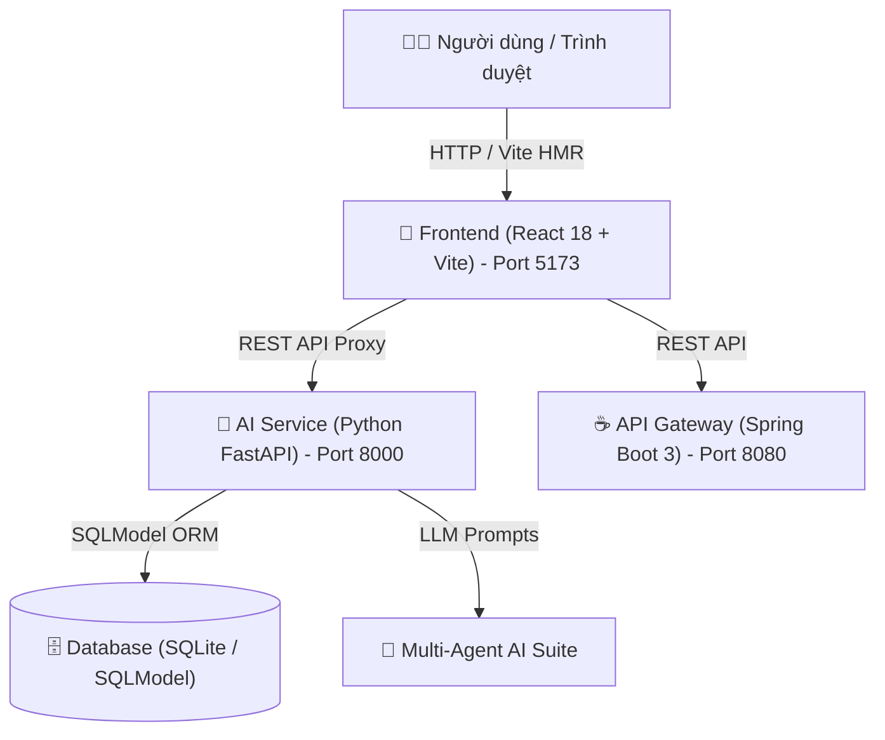

# 🚀 AI-Driven Software Project Management System
> **Hệ thống Quản lý Dự án Phần mềm Hỗ trợ bởi Trí tuệ Nhân tạo Đa Agent & Giao thức Hợp tác AI DevOps (Human-in-the-Loop Governance)**

---

## 📌 1. Tổng quan Dự án (Project Overview)

**AI-Driven Software Project Management** là một nền tảng quản lý dự án phần mềm theo phương pháp luận **Agile/Scrum** hiện đại tích hợp **Hệ sinh thái Trợ lý AI Đa Agent (Multi-Agent Architecture)** và **Mô hình Hợp tác DevOps Con người - AI (Human-AI Collaboration)**. 

Hệ thống cho phép doanh nghiệp tự động hóa các khâu phân tích yêu cầu, phân rã công việc, ước lượng độ phức tạp, đánh giá rủi ro dự báo và phân công công việc, đồng thời duy trì sự kiểm soát và giám sát an toàn của con người (Human Governance).

---

## 🏗️ 2. Kiến trúc Hệ thống (System Architecture)

Hệ thống bao gồm 3 thành phần chính hoạt động theo mô hình Microservices decoupled:



### 🛠️ Công nghệ Sử dụng (Tech Stack)
- **Frontend App**: React 18, TypeScript, Vite, Recharts, Lucide Icons, Vanilla CSS Dark Theme (Port `5173`).
- **AI Microservice**: Python 3.10+, FastAPI, SQLModel, Uvicorn, SQLite (`ai-service` Port `8000`).
- **API Gateway**: Java 17, Spring Boot 3, Spring Security, Maven (`backend` Port `8080`).
- **Bảo mật & Phân quyền**: OAuth2 / JWT Authentication, Phân quyền RBAC (Role-Based Access Control) 4 cấp độ.

---

## 🤖 3. Kiến trúc Đa Agent AI (Multi-Agent AI Suite)

Hệ thống tích hợp 6 AI Agents chuyên biệt tương ứng với từng giai đoạn phát triển dự án:

1. 🔍 **Requirement Agent (`/ai/analyze`)**:
   - Phân tích tính khả thi, phạm vi tính năng và rủi ro kỹ thuật từ câu chuyện người dùng.
   - Trả về tóm tắt tiếng Việt sạch sẽ và gợi ý tiêu chí chấp nhận (Acceptance Criteria).
2. 🎯 **Planning Agent (`/ai/story-point`)**:
   - Ước lượng điểm Story Points theo thang Fibonacci (1, 2, 3, 5, 8, 13, 21) dựa trên nguyên lý logic mờ.
   - Cung cấp lý do và cơ sở đánh giá độ phức tạp kỹ thuật.
3. ⚡ **Task Agent (`/ai/breakdown`)**:
   - Phân rã User Story thành danh sách các task con tự động.
   - Đánh giá khả năng tự động hóa (`automation_level`), mức độ rủi ro (`risk_level`) và ước tính chi phí Token AI.
4. ⚠️ **Risk Agent (`/ai/risk`)**:
   - Quét dữ liệu tiến độ và phát hiện các mối đe dọa tiềm ẩn dựa trên mô hình Mạng Bayesian.
   - Tự động đề xuất kịch bản giảm thiểu rủi ro (Mitigation Plan).
5. 📈 **Forecast Agent (`/ai/forecast`)**:
   - Dự báo khả năng hoàn thành Sprint và đường Burndown bằng Mô hình Mạng Nơ-ron Nhân tạo (ANN).
   - Đưa ra cảnh báo sớm về các điểm nghẽn tích hợp.
6. ✨ **Assignment Agent (`/ai/assign`)**:
   - Tự động đề xuất và phân công công việc cho lập trình viên dựa trên cân bằng khối lượng công việc (Workload Balance) và kỹ năng.

---

## 🛡️ 4. Giao thức Hợp tác AI DevOps (Human-AI Collaboration Protocols)

Mỗi công việc trong hệ thống được gắn một trong 3 giao thức điều phối:

| Giao thức | Tên đầy đủ | Điều kiện Kích hoạt | Cơ chế Hoạt động |
| :--- | :--- | :--- | :--- |
| 🟣 **HITL** | Human-in-the-Loop | Risk $\ge 0.60$ hoặc Aut $< 0.40$ hoặc Cost $\ge \$1.00$ | **Duyệt thủ công**: Con người phải phê duyệt từng bước trước khi AI thực thi bước tiếp theo. |
| 🔵 **HOTL** | Human-on-the-Loop | Mặc định (Default) | **Giám sát động**: AI chạy tự động, con người theo dõi và có thể nhấn **"Can thiệp"** để bơm lệnh ghi đè. |
| 🟢 **HOOL** | Human-out-of-the-Loop | Risk $< 0.30$ và Aut $\ge 0.70$ và Cost $< \$0.50$ | **Tự động hoàn toàn**: AI chạy tự động hoàn toàn, cung cấp nút **"Hoàn tác (Rollback)"** để phục hồi trạng thái cũ. |

---

## 🔑 5. Danh sách Tài khoản Demo (Demo Accounts)

Hệ thống hỗ trợ phân quyền kiểm soát truy cập dựa trên vai trò (RBAC):

| Vai trò (Role) | Username | Password | Quyền hạn tiêu biểu |
| :--- | :--- | :--- | :--- |
| **Admin** | `admin` | `admin123` | Quản trị toàn bộ hệ thống, xem nhật ký AI, cấu hình bảo mật |
| **Project Manager** | `pm` | `pm123456` | Quản lý dự án, Sprints, User Stories, phân công AI, đánh giá rủi ro |
| **Developer** | `dev` | `dev123456` | Thực thi công việc, chạy mô phỏng AI DevOps Sandbox, phân rã task |
| **Viewer** | `viewer` | `viewer123456` | Chỉ xem tiến độ, biểu đồ Burndown, báo cáo Velocity |

---

## 🚀 6. Hướng dẫn Khởi chạy Hệ thống (Quick Start Guide)

### 1️⃣ Khởi chạy AI Microservice (Python FastAPI)
```bash
cd ai-service
# Cài đặt môi trường ảo Python (nếu chưa có)
python -m venv .venv
.\.venv\Scripts\activate

# Cài đặt thư viện phụ thuộc
pip install -r requirements.txt

# Khởi chạy server FastAPI trên port 8000
python -m uvicorn app.main:app --port 8000
```

### 2️⃣ Khởi chạy API Gateway (Spring Boot)
```bash
cd backend
# Khởi chạy ứng dụng Spring Boot với Maven wrapper
.\mvnw.cmd spring-boot:run
```

### 3️⃣ Khởi chạy Frontend App (React Vite)
```bash
cd frontend
# Cài đặt npm dependencies
npm install

# Khởi chạy Vite dev server trên port 5173
npm run dev
```

📌 Truy cập ứng dụng tại địa chỉ: **`http://localhost:5173`**

---

## 📂 7. Cấu trúc Thư mục Dự án (Directory Structure)

```
AI-Driven-Software-Project-Management/
├── ai-service/              # Python FastAPI Microservice (AI Agents, Database, Seed Data)
│   ├── app/
│   │   ├── api/             # API Router Endpoints (auth, projects, sprints, tasks, risks, ai...)
│   │   ├── core/            # Security, JWT & RBAC dependencies
│   │   ├── prompts/         # Library prompt templates cho 6 AI Agents
│   │   ├── services/        # AI logic processing, CRUD & reports
│   │   ├── models.py        # SQLModel Database Schemas
│   │   └── seed.py          # Data seeding script (Projects, Sprints, Tasks, Risks)
├── frontend/                # React 18 + TypeScript Single Page Application (SPA)
│   ├── src/
│   │   ├── api/             # Axios API client & endpoints mapping
│   │   ├── components/      # UI Layout & Navigation components
│   │   ├── pages/           # Dashboard, Projects, Sprints, Stories, Tasks, Risks, Forecast...
│   │   ├── store/           # Zustand Auth State Management
│   │   └── utils/           # RBAC permission helpers
├── backend/                 # Java 17 + Spring Boot API Gateway Service
└── README.md                # Tài liệu hướng dẫn hệ thống
```

---

## 📜 8. Giấy phép & Đóng góp (License & Contribution)

Dự án được xây dựng phục vụ nghiên cứu và ứng dụng Trí tuệ Nhân tạo trong Quản lý Dự án Phần mềm theo định hướng Agile & DevOps.

© 2026 AI-Driven Software Project Management Team.
